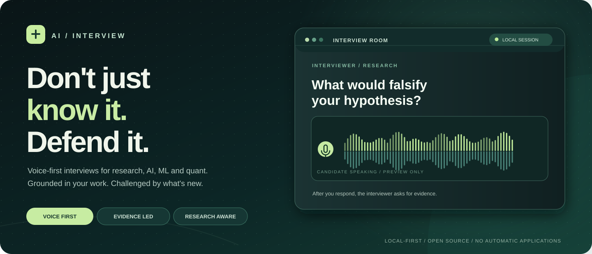
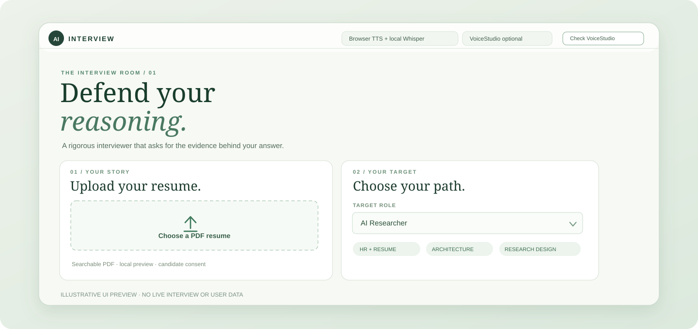
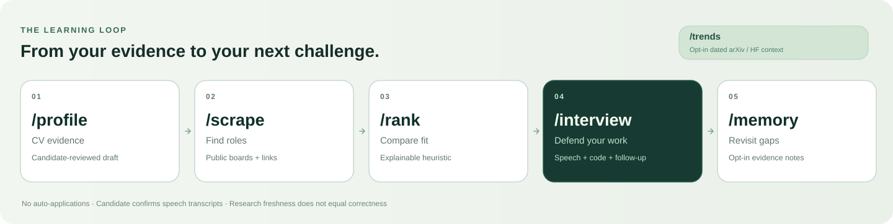

<div align="center">
  

  <p><strong>Voice-first technical interviews · CV-grounded cross-examination · Research-aware practice</strong></p>
  <p>
    <a href="#get-started">Get started</a> ·
    <a href="#how-were-different">Compare projects</a> ·
    <a href="#the-interview-experience">Explore the studio</a> ·
    <a href="README.zh-CN.md">简体中文</a>
  </p>
  <p>
    
    
    
    
  </p>
</div>

**Not another interview question bank.** AI-Interview asks you to defend the projects on your resume, tests your understanding of a role's foundations, and can challenge you with *dated, sourced* developments in your research field. It focuses on **practice before an interview**, with **no automatic applications** or covert real-interview assistance.

## Get started

**MacBook Pro / Apple Silicon:** the local Codex, Claude Code or Gemini CLI agent can run the same installer you can double-click in Finder.

```bash
git clone https://github.com/Yunbo-max/AI-Interview.git
cd AI-Interview
bash AI-Interview.command --yes
```

The first run can prepare an isolated Python environment, install the speech dependencies, download the local Whisper fallback, and install the **separate, checksum-verified VoiceStudio macOS app** on supported Apple Silicon Macs. It then starts the private local interview website. **Your Mac must still approve microphone permissions, model licences and any Gatekeeper prompts.** A supported interviewer CLI must already be installed and authenticated, or you must configure a supported API key.

<details>
<summary><strong>More launch options · inspection, lightweight mode, stop</strong></summary>

```bash
bash AI-Interview.command --doctor           # read-only environment check
bash AI-Interview.command --dry-run          # proposed installs, no downloads
bash AI-Interview.command --launch-only      # reopen a running studio
bash AI-Interview.command --stop             # authenticated local shutdown
bash AI-Interview.command --no-voicestudio --yes  # built-in Whisper + browser voice
```

VoiceStudio's packaged local backend requires an **Apple Silicon Mac with macOS 13.3+**; Intel Macs can instead use the independent Faster-Whisper/browser-speech path. Plan for roughly **10 GB of disk space** for VoiceStudio and its initial environment, with more for optional models. Real Mac setup and speech latency remain device-specific and unverified by our automated tests.

[Mac / agent installation guide](skills/ai-interview/references/one-click-mac.md) · [VoiceStudio setup](skills/ai-interview/references/voicestudio-backend.md)

</details>

## The interview experience

<div align="center">
  
  <sub>Illustrative UI preview based on the current setup screen. Not a live interview, real candidate, or measured result.</sub>
</div>

| Before the interview | During the interview | After the interview |
| :--- | :--- | :--- |
| Upload a **searchable PDF resume**; review extracted text. Select one of six roles, optionally a saved job description and recent research. | **Hear a question** (browser voice or optional VoiceStudio TTS). **Speak your answer**; review the local transcript before submitting. Coding questions switch to a text editor. | Receive a **model-generated review and reference answers**, export the report, and optionally save a small private memory summary for later practice. |

**Speaking is the default, not the only input.** VoiceStudio supports streaming transcript previews; **only the final transcript you confirm is sent to the chosen interviewer model.** This is currently *turn-based*, not full-duplex speech. Candidate code is **not executed** by the built-in editor.

### Timekeeper Agent · sensible time pressure, not arbitrary penalties

A **separate deterministic local Timekeeper** now records question-by-question active seconds while the interviewer focuses on technical follow-ups. It does **not** call another LLM, listen for acoustic silence, open the microphone, auto-skip a question, or judge correctness from time taken. The browser displays a per-question clock alongside the existing 60-minute session clock, and can speak a short reminder when you are **not** recording.

| Question type | First reminder | Progress nudge | Offer to skip |
| :--- | ---: | ---: | ---: |
| **HR / resume** | **1 minute** | **2 minutes** | **5 minutes** |
| Transformer / RL / Agent / ML / Systems / Quant | 1m 30s | 3 minutes | 5 minutes |
| **Math / research / generative** | 2 minutes | 4 minutes | 6 minutes |
| **Coding** | 5 minutes | 10 minutes | 15 minutes |

You can explicitly **add one minute** (up to twice; suggested question pacing only), **skip without a negative assessment**, or **pause** the session. Local model inference and bound Whisper/VoiceStudio **transcription processing** are excluded from candidate active time. The total session still ends at 60 active minutes, with a warning at five and one minute remaining; the review includes a per-question timing ledger. **No submission is not the same as silence or a wrong answer.** A closed tab cannot receive an audible reminder—pause before leaving. [Timing contract and known limits](skills/ai-interview/references/timekeeper-agent.md).

### Choose your track

| Quant & engineering | AI & research |
| :--- | :--- |
| **Quant Researcher** — probability, statistics, stochastic processes, Python and research methods | **AI Researcher** — attention, model architectures, RL, research design and ablations |
| **Quant Developer** — algorithms, data structures, performance, concurrency | **LLM / Agent Engineer** — coding, transformers, tools, MCP, planning and evaluation |
| **ML Engineer** — ML foundations, training, deployment and systems | **Generative AI Researcher** — diffusion, score/flow methods, multimodal models and experiment design |

Every role starts with **HR + resume claim defense**. Technical phases and questions adapt to the selected track, candidate responses and optional JD. The one-hour phase plan is a target, **not a certified one-hour endurance test**.

## One learning loop, not isolated practice sessions

<div align="center"></div>

| Command | What it actually does |
| :--- | :--- |
| **`/profile`** | Extract a PDF CV locally and make an editable, source-preserving Markdown draft; optional LLM polishing requires consent. |
| **`/scrape`** | Open a LinkedIn **search link**, or fetch public Greenhouse/Lever employer boards; import your own JD. **No unauthorized LinkedIn scraping.** |
| **`/rank`** | Show explainable CV-to-role/JD matches and gaps using a **heuristic**, not an admission or hiring probability. |
| **`/interview`** | Run the role-specific, voice-first interview with CV/JD defense, technical follow-ups and an optional coding editor. |
| **`/memory`** | Record opt-in session coverage and topic evidence for re-practice; no automatic transcript archive. |
| **`/trends`** · optional | Retrieve dated arXiv/Hugging Face Daily Papers metadata to inspire technical follow-ups. **Abstracts are not paper verification.** |

**An old assessment is not proof of forgetting.** Memory separates demonstrated knowledge, topics due for reassessment and new developments in a field. Research refresh is opt-in and respects publication/retrieval dates; popularity is not evidence of scientific correctness.

## How we're different

Voice interviews **already exist** in open source. Our focus is the combination of **research/quant-specific cross-examination**, **dated technical developments** and **candidate-controlled practice evidence** — not a claim to have invented speech interviews.

| | **AI-Interview (this project)** | [ai-job-search](https://github.com/MadsLorentzen/ai-job-search) | [DeepInterview](https://github.com/ngoanpv/DeepInterview) | [VoiceStudio](https://github.com/debpalash/VoiceStudio) |
| :--- | :--- | :--- | :--- | :--- |
| **Primary purpose** | Technical/research interview practice | Job discovery, applications and interview preparation | Real-time spoken mock interviews and coaching | Audio generation, transcription and voice workflows |
| **Interview conversation** | **Turn-based voice**, critical follow-ups, timed reminders and resume defense | Stage/JD-specific prep; optional chat roleplay | **Real-time voice** with barge-in in its live-provider path | Speech APIs, **not** an interviewing agent |
| **Technical angle** | **Quant, ML, Transformers, RL, Agents, Diffusion** | Tailored to job applications | Adaptive CV/JD-based interviews and question packs | ASR/TTS engines and voice profiles |
| **Research freshness** | Optional **dated arXiv/HF abstracts** for technical challenges | Company and role research | Company research and study coaching | Not an interview-research product |
| **After the session** | Opt-in topic evidence/coverage; reassess without assuming forgetting | Application tracker, feedback and outcomes | Scored report and study coach | Voice/audio project history |
| **Our current limitation** | No code execution, true full duplex or real-Mac endurance certification | Not a standalone speech interview studio | More components/provider setup for its live path | Requires separate installation; AGPL-3.0 and model-specific terms |

<sub>Scope comparison based on public project documentation reviewed 2026-10-16; **not** an official GitHub Trending ranking, benchmark or assertion that unlisted features are absent. DeepInterview has a more developed real-time voice stack than our current turn-based release. See each linked repository for its latest status.</sub>

## Model and speech backends

AI-Interview separates **the interviewer** (reasoning) from **the voice** (speech). They are independently selected and independently consented to.

| Layer | Choices | Notes |
| :--- | :--- | :--- |
| **Interviewer models** | Codex CLI · Claude Code CLI · Gemini CLI · Qwen · DeepSeek · GLM · Kimi | Local CLI login or provider API key required; 7 routes are configured, **not all real-account certified**. |
| **Lightweight speech** | Browser SpeechSynthesis + local Faster-Whisper | No VoiceStudio install required; STT runs locally once its model is downloaded. |
| **Optional voice engine** | [VoiceStudio](https://github.com/debpalash/VoiceStudio) | Separate local app for TTS + streaming/batch STT. Audio stays local **only if its own selected engine is local**. Model licences remain independent. |

### Privacy & honest limitations

- **Your resume, raw recording and unsubmitted text are not committed to GitHub.** PDF parsing is local; the interview page does not intentionally persist raw recordings. Persistent candidate workspace defaults to `~/.local/share/ai-interview/`.
- **LLM calls are not automatically offline.** After explicit consent, the selected model provider receives confirmed answers and the chosen CV/JD/context. VoiceStudio can also be configured with optional remote engines; check its settings.
- **No auto-applications or hidden interview assistance.** The app does not log in to LinkedIn, control a mouse, execute arbitrary candidate code, infer personality from speech or promise interruption-quality full duplex.
- **Verification is scoped.** v0.7.0 passed 177 Python tests and six Node UI simulation suites; see the [Timekeeper verification](docs/TIMEKEEPER-VERIFICATION.md) for exact results. Mac installation, actual microphones, voice-model quality, all provider accounts and continuous one-hour sessions have **not** been certified on real devices.

[Installer verification](docs/ONE-CLICK-MAC-VERIFICATION.md) · [Voice bridge verification](docs/VOICESTUDIO-VERIFICATION.md) · [Career workflow verification](docs/CAREER-VERIFICATION.md) · [Source and research rules](docs/SOURCES.md)

---

<div align="center">
  <strong>Defend your work. Explain the fundamentals. Keep up with what changed.</strong>
  <br />
  <sub>Open source · MIT · Local-first · Built for practice, not shortcuts.</sub>
  <br />
  <a href="README.zh-CN.md">阅读中文版</a> · <a href="skills/ai-interview/SKILL.md">Explore the Skill</a>
</div>
